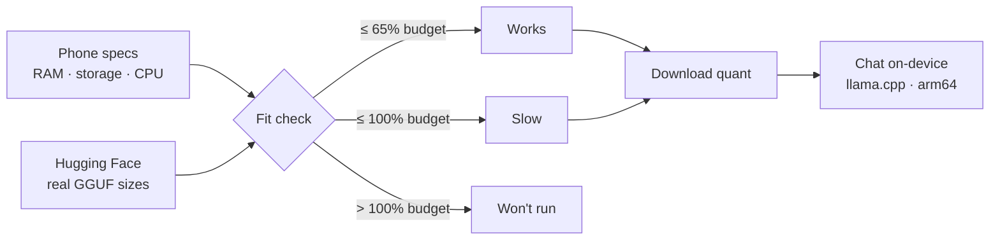

<div align="center">

# Mmodel

**Run GGUF LLMs on your Android phone — find models that fit, download them, and chat fully offline.**

Mmodel = **m**obile **model**. It reads your phone's real RAM, storage and CPU, checks the actual
file sizes published on [Hugging Face](https://huggingface.co), and tells you which quantizations
will **work**, be **slow**, or **won't run** — before you spend gigabytes downloading.

[](https://github.com/soumik183/Mmodel/actions/workflows/android.yml)
[](https://github.com/soumik183/Mmodel/releases)
[](https://github.com/soumik183/Mmodel/releases)
[](#requirements)
[](#build)
[](#requirements)

[**⬇ Download the latest APK**](https://github.com/soumik183/Mmodel/releases/download/latest/app-release.apk)
&nbsp;·&nbsp;
[Features](#features) &nbsp;·&nbsp;
[Install](#install) &nbsp;·&nbsp;
[How fit works](#how-the-fit-estimate-works) &nbsp;·&nbsp;
[Build](#build) &nbsp;·&nbsp;
[FAQ](#faq)

</div>

---

## Why Mmodel?

Most "AI on Android" apps either stream from a server or dump a model file on you and hope for the
best. Mmodel answers the question that actually matters first:

> **Will this model run on *my* phone?**

- **Real numbers, not guesses.** Fit is computed from the actual GGUF file sizes Hugging Face
  publishes, including every shard of a quantization — not from parameter counts.
- **Private by design.** No account, no analytics, no tracking, no model server. Prompts and replies
  never leave the device. The app requests only the `INTERNET` permission.
- **One flow from discovery to chat.** Search Hugging Face, pick a quantization, download it with
  pause/resume, then talk to it in the same app.
- **Open source and reproducible.** Kotlin + Jetpack Compose. Every push to `main` is tested and
  built in GitHub Actions, and a signed APK is published automatically.

## Features

- **Live device profile** — RAM, free storage, CPU cores, ABI, chipset, OpenGL ES version, Android
  version, and whether local chat is supported
- **Hugging Face search** — 20 results per page, infinite scroll, sort by trending / likes / recently
  updated, and category filters
- **Categories** — All, GGUF, Chat, Vision, Audio, Text to speech, Speech to text and Embeddings;
  task categories are constrained to GGUF so they stay download- and chat-friendly
- **Real-data fit estimate** — actual GGUF file sizes (multi-shard quants summed), per-quant fit
  badges, RAM overhead, and free-storage checks
- **Model vs phone comparison** — side-by-side memory, download and local-chat checks using the same
  numbers as the verdict
- **Recommended for you** — chat-ready GGUF picks size-checked against this phone's RAM and free
  storage, streamed in as soon as each real size arrives
- **Model details** — parameters, context length, downloadable quants, downloads, likes, tags, and a
  direct Hugging Face link
- **Downloads** — choose a quantization, see the exact app-private folder and file sizes,
  pause/resume with HTTP Range, delete with confirmation, and browse downloaded models
- **Import from storage** — pick any model file with Android's document picker: GGUF, safetensors,
  PyTorch, ONNX, TFLite or CoreML. Imports are typed from the file name (text, vision, TTS, STT,
  image, embeddings, projector), and single-file text GGUFs load through a file descriptor so the
  original file is not copied into app storage. Other formats are kept for reference and clearly
  marked as not chat-capable instead of failing at load time
- **Download guardrails** — warns when a quant is Slow / Won't run / missing a reported size, is
  sharded, or is not chat-ready before the download starts
- **Local chat** — llama.cpp inference on `arm64-v8a`, streaming tokens, stop generation, regenerate,
  copy a reply, clear conversation, unload the model, and a conservative 2K context
- **Premium Material 3 UI** — transparent glass navigation, animated selection states, aurora
  indigo/teal palette, adaptive launcher icon, squircle letter avatars, and light/dark themes
- **Light on startup** — Explore loads the first 20 matches on first visit, while recommendations
  appear progressively instead of waiting for every size lookup

## Install

**Direct download (rolling latest):**
[**app-release.apk**](https://github.com/soumik183/Mmodel/releases/download/latest/app-release.apk)

Or open the [latest release page](https://github.com/soumik183/Mmodel/releases/latest), the
[rolling latest tag](https://github.com/soumik183/Mmodel/releases/tag/latest), or grab the
`Mmodel-signed-apk` / `Mmodel-debug-apk` artifact from the
[Actions tab](https://github.com/soumik183/Mmodel/actions).

1. Download the APK on the phone.
2. Allow install from your browser or files app when Android asks.
3. Open **Mmodel → Explore**, search for a model, and open the one you want.
4. Pick a quant marked **Works**, download it, then open **Chat**.

> The APK ships only the `arm64-v8a` native engine.
>
> **Requires a 64-bit ARM Android phone running Android 8.0 (API 26) or newer.**
>
> Switching from a debug build to a release-signed build requires uninstalling the debug app first,
> because the signing keys differ.

## Requirements

| Item | Requirement |
| --- | --- |
| Android | 8.0 (API 26) or newer |
| CPU | 64-bit ARM (`arm64-v8a`) |
| Storage | Free space for the quant you choose, plus a 300 MB reserve |
| Network | Only for searching and downloading models |
| Chat | Needs the `arm64-v8a` llama.cpp runtime built into the APK |

## How the fit estimate works

1. Read the **actual published GGUF file sizes** in the repo. All shards of one quantization are
   summed; projector, LoRA, importance-matrix, MTP and tokenizer helper files are ignored. For
   non-GGUF repos, safetensors / PyTorch / ONNX weight sizes are summed.
2. Present one download option per quantization with its own fit badge.
3. Estimate runtime RAM: `file size × 1.15 + 350 MB runtime + 125 MB per 1K context tokens`
   (GGUF) or `file size × 1.2 + 600 MB runtime + 150 MB per 1K tokens` (other formats). At the
   2K chat cap this is the same 600 MB / 900 MB allowance, but a larger context now scales instead
   of silently underestimating.
4. Compare with a safe budget: `min(total RAM − 1.5 GB, 75% of total RAM)`.
   - `≤ 65%` of budget → **Works**
   - `≤ 100%` → **Slow**
   - `> 100%` → **Won't run**
5. If a model fits the budget but not the RAM free right now (90% headroom), the verdict is
   downgraded to **Slow** and the exact shortfall is shown, so "Works" reflects the phone as it is
   running, not just what it could theoretically give an app.
6. When several quants are published, the smallest **single-file** quant is picked as the best
   download, because chat cannot load a sharded GGUF; a smaller shard set no longer wins.
7. If the download plus 300 MB does not fit in free storage → **Won't run**, with the exact missing
   bytes reported.
8. The model screen repeats the exact comparison: estimated RAM vs the safe budget and free RAM,
   download size vs free storage (including the 300 MB reserve), and GGUF layout vs the arm64
   llama.cpp runtime.
   Context is shown alongside the app's 2K local-chat cap.
7. The device card shows live RAM and storage and has a **Recheck** action.



Quantization, context length, background apps, thermals and the runtime all change real
performance. **This is a guide, not a benchmark.**

## Local chat

Chat loads a downloaded or imported GGUF through `io.github.ljcamargo:llamacpp-kotlin` 0.2.0
(`llama.cpp`, `arm64-v8a`). It uses a 2K context, 4 threads when available, and streams tokens into
the conversation.

- Models marked **Won't run** are blocked from loading to avoid native out-of-memory crashes.
- **Slow** models can be loaded, with a warning to keep the conversation short.
- The model's own chat template is requested from the GGUF first; a family fallback (ChatML, Llama 3,
  Gemma, Phi-3, Mistral) is used when it is unavailable.
- Use **Regenerate** to re-answer the last question, **Copy** to copy a reply, and **Unload** to free
  RAM when done.
- The first load can take a while; reading several GB from flash is expected.

## Downloads and storage

Models are stored in app-specific external storage:

```
/Android/data/com.m.model/files/models/<author>_<model>/<file>.gguf
```

The Downloads tab shows the absolute folder path and a copy button. Files survive app restarts and
can be paused/resumed. They are removed when you uninstall Mmodel.

- One download runs at a time.
- Partial files are kept for Resume.
- Multi-shard GGUF quants are downloaded together. Local chat currently supports **single-file GGUFs
  only** because the bundled runtime loads one model file descriptor.
- **Imported models** stay in their original folder and are read through a persisted Android
  Storage Access Framework URI. They are not copied into app storage. Deleting the imported record
  in Mmodel does not delete the original file. If a provider revokes access after a restart, import
  the file again. GGUF imports are validated by their magic bytes and version; safetensors, PyTorch,
  ONNX, TFLite and CoreML imports are detected from the extension and marked as not chat-capable.
- Gated/private Hugging Face repos return HTTP 401/403; accept access on the website first. A token is
  not stored by the app.

## Build

The project standardizes on:

- Kotlin 2.2.20, AGP 8.7.3, Gradle 8.9, JDK 17
- compileSdk / targetSdk 35, minSdk 26
- Jetpack Compose Material 3 (BOM 2024.12.01)
- `llamacpp-kotlin` 0.2.0, packaged for `arm64-v8a`

CI uses `gradle/actions/setup-gradle` with Gradle 8.9, so no Gradle wrapper is committed.

Locally, with a JDK and Android SDK installed:

```bash
gradle :app:testDebugUnitTest :app:assembleDebug
```

The APK is written to `app/build/outputs/apk/debug/app-debug.apk`.

### Release signing

Create a keystore once, keep it private, and add these repository secrets
(`Settings → Secrets and variables → Actions`):

| Secret | Value |
| --- | --- |
| `KEYSTORE_BASE64` | Base64-encoded keystore file |
| `KEYSTORE_PASSWORD` | Keystore password |
| `KEY_ALIAS` | Key alias |
| `KEY_PASSWORD` | Key password |

```bash
keytool -genkeypair -v -keystore mmodel-release.jks \
  -alias mmodel -keyalg RSA -keysize 2048 -validity 10000
base64 -w0 mmodel-release.jks > keystore.b64
gh secret set KEYSTORE_BASE64 < keystore.b64
gh secret set KEYSTORE_PASSWORD
gh secret set KEY_ALIAS --body mmodel
gh secret set KEY_PASSWORD
```

Actions decodes the keystore to a temporary file, builds `assembleRelease` with those values, verifies
the signature with `apksigner`, and publishes:

- a versioned release, `v<versionName>` (for example `v1.6`), and
- the rolling `latest` release used by the download link above.

Never commit the keystore or passwords.

## Project layout

```
app/src/main/java/com/m/model/
  MainActivity.kt
  data/           Hugging Face models + API, device specs, fit logic,
                  download store, chat prompt, llama.cpp engine
  ui/             ViewModel, navigation, formatting
  ui/components/  Letter avatars, badges, cards, rows
  ui/screens/     Home, Explore, Model detail, Downloads, Chat
  ui/theme/       Material 3 theme and shapes
app/src/test/     JVM tests for fit, quantization parsing, chat prompts
design/           Source SVG for the adaptive launcher icon
.github/workflows/android.yml
```

## FAQ

<details>
<summary><strong>Does Mmodel send my prompts anywhere?</strong></summary>

No. Inference runs on the phone with llama.cpp. There is no account, analytics or telemetry, and the
app only uses the network to search and download models from Hugging Face.
</details>

<details>
<summary><strong>Can I run Llama 3, Qwen, Gemma, Phi or Mistral on my phone?</strong></summary>

Yes, if the repo publishes a GGUF quantization that fits your RAM and the quant is a single file.
Mmodel labels each quant **Works**, **Slow** or **Won't run** using the real file size and your safe
RAM budget.
</details>

<details>
<summary><strong>Why does a model say "Won't run"?</strong></summary>

Either its estimated runtime RAM is above your safe budget, or the download plus the 300 MB reserve
does not fit in free storage. Try a smaller quantization (for example `Q4_K_M` instead of `Q8_0`).
</details>

<details>
<summary><strong>Why can't Chat load a split (sharded) GGUF?</strong></summary>

The bundled llama.cpp runtime loads one file descriptor, so it cannot discover the sibling shards.
Mmodel downloads sharded quants and warns you, but Chat only runs single-file GGUFs. Choose a quant
published as one `.gguf` file.
</details>

<details>
<summary><strong>Does it work on armv7, x86 or iOS?</strong></summary>

No. The native engine is built for `arm64-v8a` only. Most phones from 2017 onward are 64-bit ARM.
</details>

<details>
<summary><strong>Is there a Play Store version?</strong></summary>

Not yet. Releases are signed APKs published on GitHub. Android will ask you to allow installs from
your browser or files app.
</details>

## Notes and limitations

- Hugging Face's public API is used without a token. Heavy use can be rate-limited (HTTP 429);
  transient 5xx and rate-limit responses are retried with backoff.
- Explore loads 20 models at a time and fetches the next page near the end of the list. The leading
  cards on each page are enriched with full file sizes; any remaining card loads its exact sizes when
  opened.
- The **All** category can include non-GGUF models. Task categories add a GGUF filter so they stay
  download- and chat-friendly.
- Only published weight-file sizes are used. Repos without sizes show **Unknown**; those files can
  still be downloaded with a warning, and the app reads the size from the download response when
  available.
- Local chat is experimental and limited to single-file GGUFs on `arm64-v8a`.
- Gated/private models cannot be downloaded through the app; the link opens Hugging Face.
- Release APK signing requires the four repository secrets above; without them, CI publishes a
  debug-signed APK.

## Contributing

Found a bug or have an idea? [Open an issue](https://github.com/soumik183/Mmodel/issues) with the
model repo, quant, phone model and the exact message you saw. Pull requests are welcome — keep the
change focused, run `gradle :app:testDebugUnitTest`, and describe what you verified on a device.

---

<div align="center">

Built with Kotlin, Jetpack Compose and llama.cpp.

**Mmodel — local AI, on your phone.**

</div>
